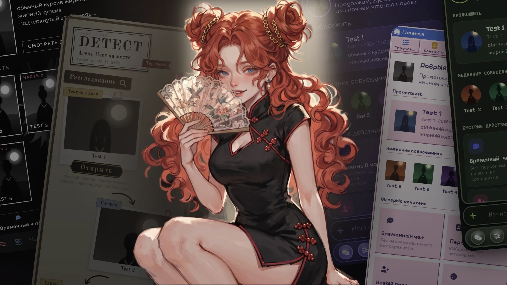
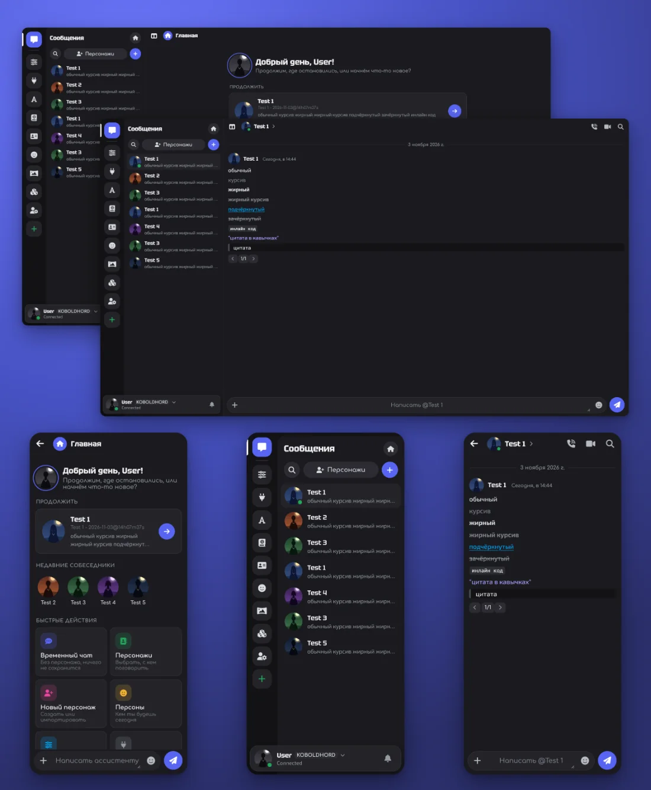
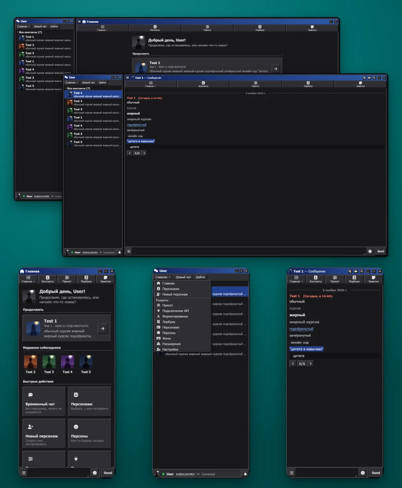
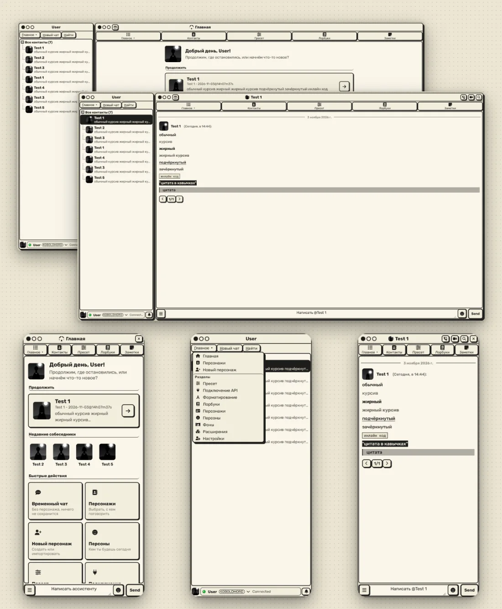
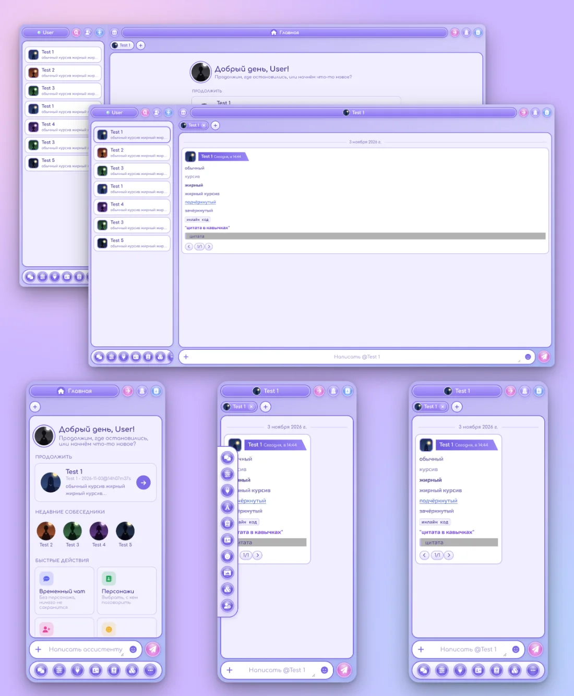
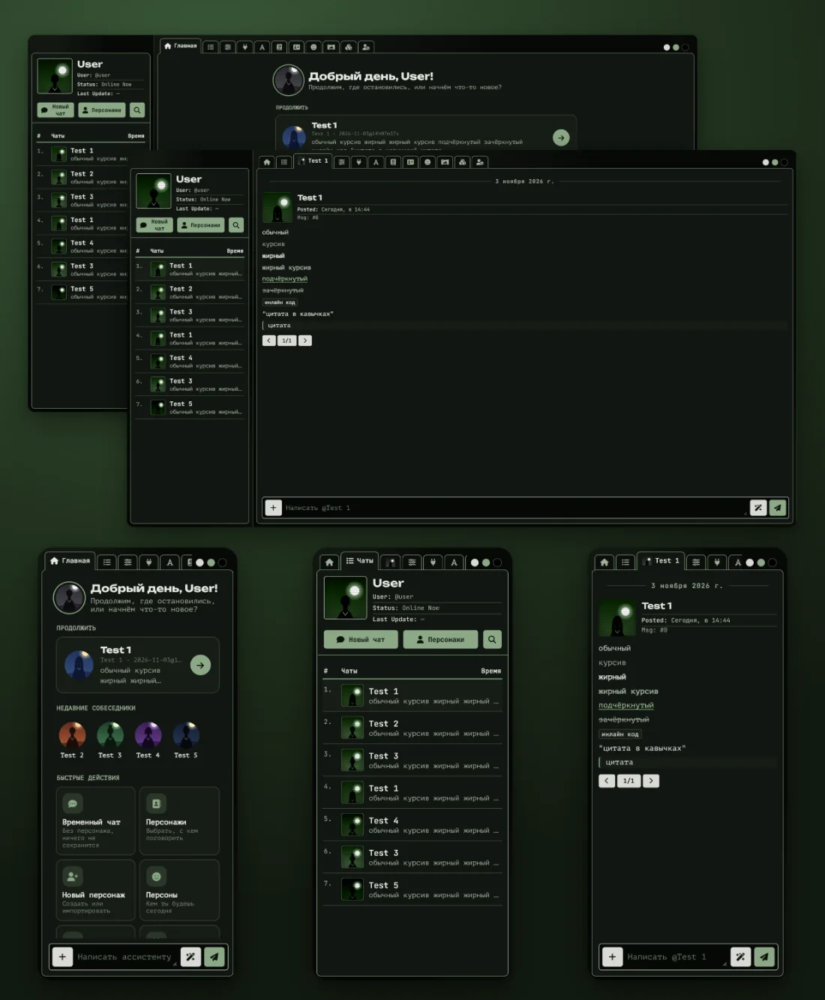
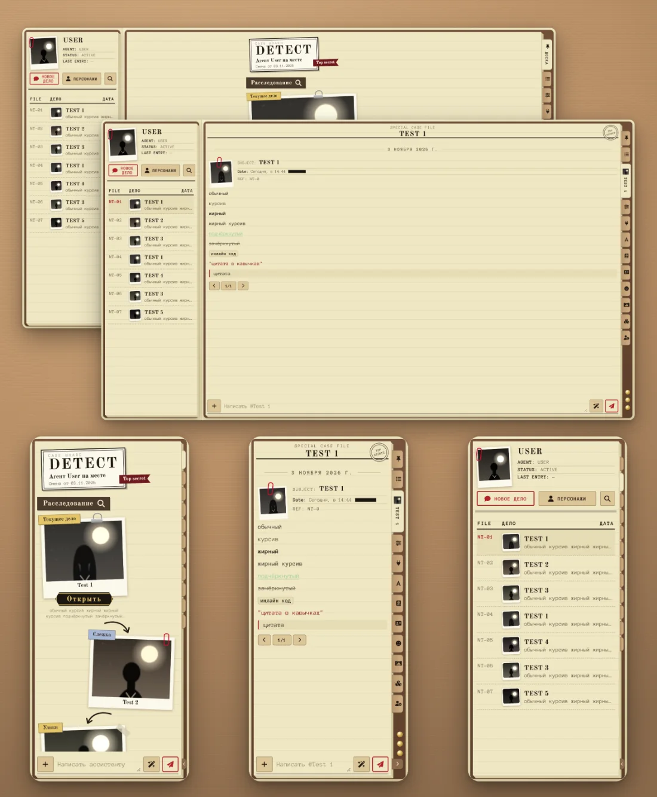
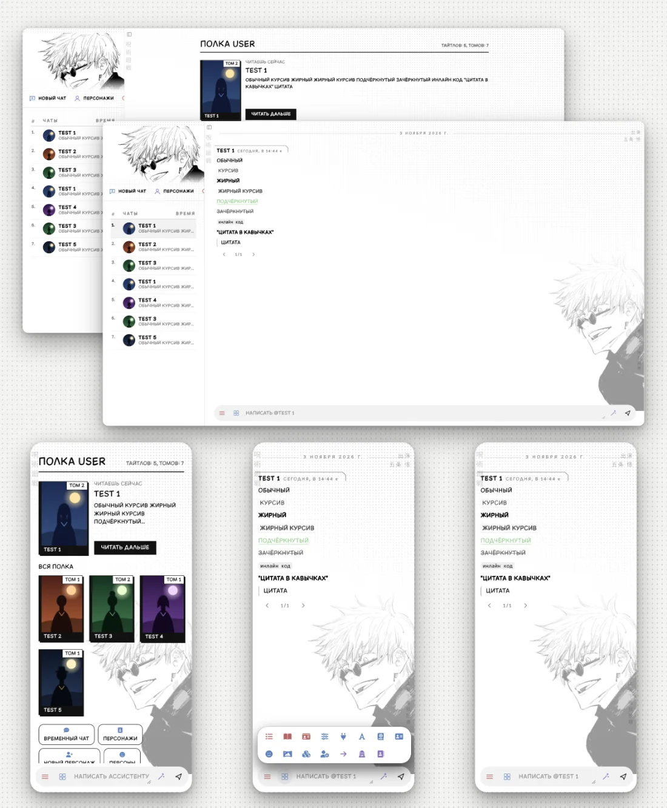
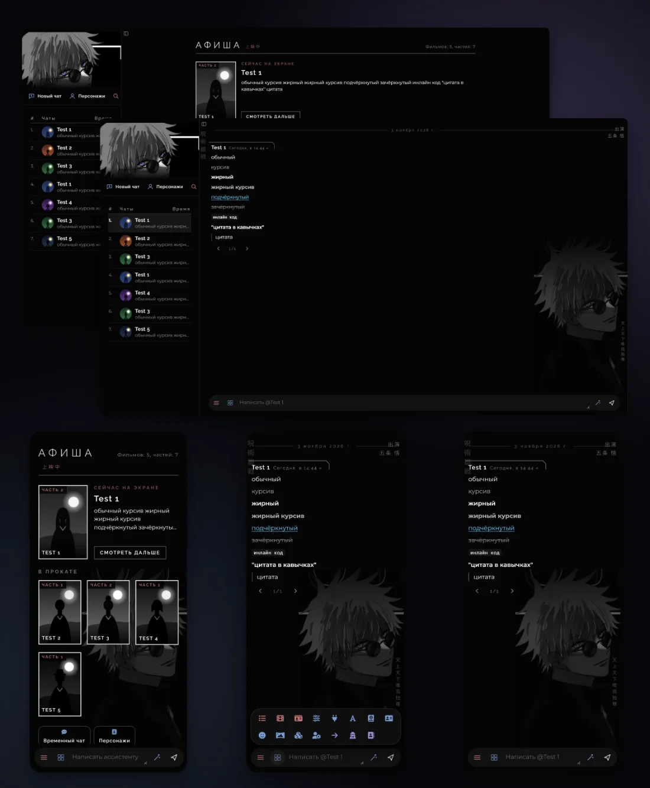
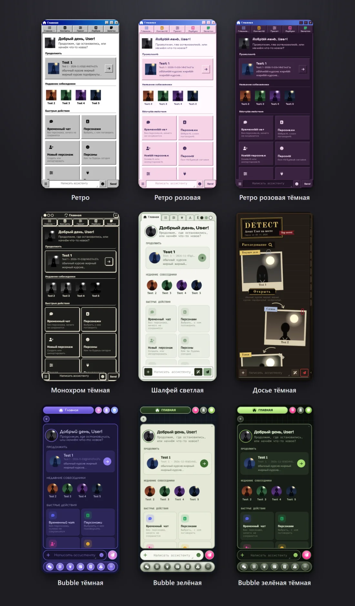

# MoonThemes



Расширение для SillyTavern, которое переодевает таверну целиком: список чатов, окно сообщений, главная страница, разделы таверны и панели. 8 тем и 9 перекрасов к ним, у каждой своя раскладка, а не только цвета. Работает на телефоне и на ПК.

## Установка

1. В SillyTavern открой **Расширения** → **Установить расширение**.
2. Вставь ссылку и нажми «Установить»:
   ```
   https://github.com/moonnsy/MoonThemes
   ```
3. Обнови страницу. Тему выбирают в **Расширения** → **MoonThemes** → **Тема**.

При смене темы расширение ставит свой файл темы таверны (цвета текста, курсива, цитат) и перезагружает страницу. Прежняя тема таверны остаётся в списке тем, её можно вернуть там же.

## Темы

| | |
|:-:|:-:|
| **Discord** | **Ретро** |
|  |  |
| **Монохром** | **Bubble** |
|  |  |
| **Шалфей** | **Досье** |
|  |  |
| **Годжо** | **Годжо тёмная** |
|  |  |

### Перекрасы

Ретро, Ретро розовая, Ретро розовая тёмная, Монохром тёмная, Шалфей светлая, Досье тёмная, Bubble тёмная, Bubble зелёная, Bubble зелёная тёмная.



## Что умеет

- **Телефон и ПК.** На широком окне включается версия для ПК: список чатов, разделы и чат стоят колонками. Границы колонок тянутся мышкой, двойной клик по границе возвращает как было.
- **Своя главная страница**: продолжить последний чат, недавние собеседники, быстрые действия. В Годжо вместо неё полка (в светлой) и афиша (в тёмной). Можно вернуть классическую от таверны.
- **Разделы таверны** (персонажи, персоны, пресеты, лорбуки и остальное) открываются в оформлении темы, у каждой темы кнопки разделов стоят по-своему.
- **Меню сообщения** по долгому нажатию: редактировать, перегенерировать, продолжить, копировать текст, удалить. Закрывается смахиванием вниз.
- **Ловец плавающих кнопок**: собирает кнопки других расширений за язычок на краю экрана, чтобы они не закрывали чат.
- **Кнопки в шапке чата** настраиваются под себя.
- **Bubble**: вкладки открытых чатов и три места для круглых кнопок разделов: под полем ввода, в выдвижной панели слева или наверху.
- **Start Page**: если стоит расширение Start Page, его заметки, теги и закрепы видны в списке чатов.

## Настройки

Всё в **Расширения** → **MoonThemes**: тема, анимации, версия для ПК, стартовая страница, ловец кнопок, кнопки шапки. Там же галочка **Включить MoonThemes**: если снять её, таверна вернётся к обычному виду, а панель настроек останется, чтобы включить обратно.

## Авторы

Сделала [moonnsy](https://github.com/moonnsy), телеграм-канал: [t.me/moonnsypic](https://t.me/moonnsypic).

Шрифт QR Comic в теме Годжо идёт со своей лицензией: `assets/gojo/fonts/QrComic-license.txt`.
